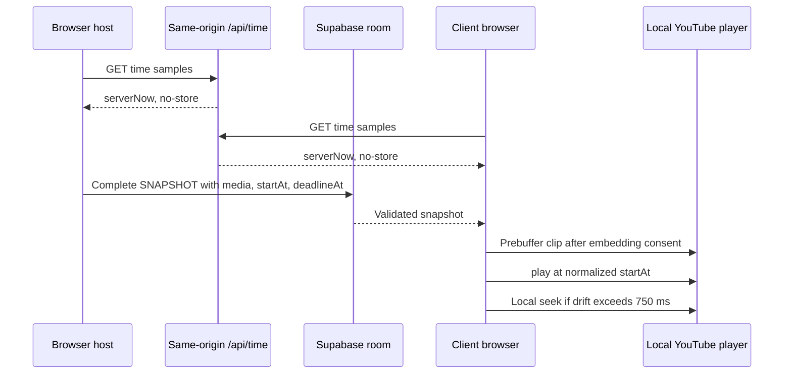

# Architecture

## Implemented in M0

Vite/React strict TypeScript shell, Tailwind styles, Zustand language selection and i18next DE/EN resources. No service is contacted; no game state is persisted. `src/main.tsx` integrates `src/ui/Shell.tsx`. `src/content/genres.json` defines fifty stable bilingual genres. `src/shared/` holds strict Zod primitives, separate defaulted local/required wire settings, GameState/phase/result schemas, commands and network envelopes. UI engine access is restricted to the public `src/engine/selectors.ts` entry when M1 creates it; other engine imports fail lint. Engine net/player/UI dependencies fail lint, including extensionless TypeScript imports.

## Contract invariants

- Settings defaults apply only to local input. Wire settings require every field.
- `roomId` identifies a session; the human room code is not a reservation or authority proof. Only discovery STATE_REQUEST may have null roomId.
- `stateVersion` orders complete snapshots; hostEpoch and hostBaseVersion identify migration lineage. Sender/connection/epoch authority additionally requires M2 adapter context, not just schema validity.
- Unique IDs, record identity, participants, owners, song references, own-vote/flag exclusion, HTTPS i.ytimg.com thumbnails, bounded media/clips and deadlines are validated before state acceptance.
- Zero/one-song results require zero player and owner deltas, no Borda, bonus or genre-fail penalty; empty song arrays do not bypass validation.
- Commands carry gameNumber/roundNumber to reject stale same-phase commands. Engine time and nonzero uint32 RNG seed are injected. Orthogonal pause preserves phase; accepted submissions/ballots/flags survive departure.
- No parallel PLAY_EVENT: authoritative playback is solely phase index/startAt/deadlineAt plus round playbackOrder/media in a complete snapshot.
- SNAPSHOT_ACK is one designated replica's schema-accepted receipt, not server ACK or persistence. Snapshot parts are transport frames only; M2 must reassemble atomically and validate the complete event.

## Planned playback synchronization (M2/M4, not implemented)

The API/player/transport paths above are future milestones. Advertisements, cold seeks, buffering, autoplay policies and browser scheduling can prevent the ±500ms target. Presence timeout/partitions can prevent five-second migration; measure AK goals, never represent them as API guarantees. See ADR-001 and SECURITY.md.
