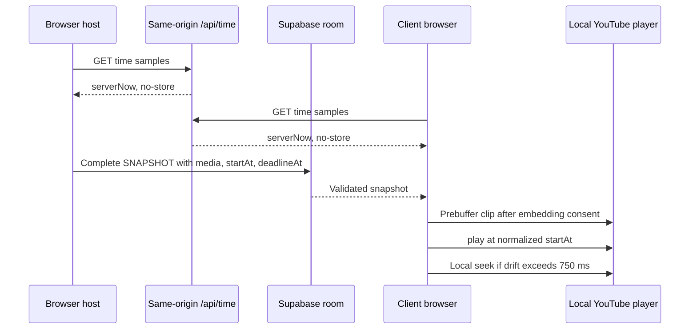

# Architecture

## Implemented in M0

Vite/React strict TypeScript shell, Tailwind styles, Zustand language selection and i18next DE/EN resources. No service is contacted; no game state is persisted. `src/main.tsx` integrates `src/ui/Shell.tsx`. `src/content/genres.json` defines fifty stable bilingual genres. `src/shared/` holds strict Zod primitives, separate defaulted local/required wire settings, GameState/phase/result schemas, commands and network envelopes. UI engine access is restricted to the public `src/engine/selectors.ts` entry when M1 creates it; other engine imports fail lint. Engine net/player/UI dependencies fail lint, including extensionless TypeScript imports.

## Contract invariants

- Settings defaults apply only to local input. Wire settings require every field.
- `rouletteGenrePool` retains the injected 30–50-genre catalogue on every complete snapshot. Active `genrePool` derives from settings: catalogue for roulette, custom items for custom, one fixed genre for fixed. Constructor argument `genrePool` supplies the source catalogue even for a fixed/custom start; switching modes back to roulette restores it, without a module cache or static fallback.
- `roomId` identifies a session; the human room code is not a reservation or authority proof. Only discovery STATE_REQUEST may have null roomId.
- `stateVersion` orders complete snapshots; hostEpoch and hostBaseVersion identify migration lineage. Sender/connection/epoch authority additionally requires M2 adapter context, not just schema validity.
- Unique IDs, record identity, participants, owners, song references, own-vote/flag exclusion, HTTPS i.ytimg.com thumbnails, bounded media/clips and deadlines are validated before state acceptance.
- Zero/one-song results require zero player and owner deltas, no Borda, bonus or genre-fail penalty; empty song arrays do not bypass validation.
- Commands carry gameNumber/roundNumber to reject stale same-phase commands. Engine time and nonzero uint32 RNG seed are injected. Orthogonal pause preserves phase; accepted submissions/ballots/flags survive departure.
- No parallel PLAY_EVENT: authoritative playback is solely phase index/startAt/deadlineAt plus round playbackOrder/media in a complete snapshot.
- SNAPSHOT_ACK is one designated replica's schema-accepted receipt, not server ACK or persistence. Snapshot parts are transport frames only; M2 must reassemble atomically and validate the complete event.
- Election and designated-replica ties use locale-independent code-unit clientId ordering after joinedAt. Election prefers players over spectators; replica ACK selection deliberately does not.

## Pure engine and public UI boundary

The M1 kernel is in `src/engine/`. Host/Net integration uses `index.ts`; UI imports only `selectors.ts`. The shell does not dispatch gameplay yet.

| API                                                                      | Contract                                                                                                                                                                                                                                                                                                         |
| ------------------------------------------------------------------------ | ---------------------------------------------------------------------------------------------------------------------------------------------------------------------------------------------------------------------------------------------------------------------------------------------------------------- |
| `createInitialState`                                                     | Inject valid room/player IDs, the full catalogue, complete settings, integer normalized server time and a nonzero uint32 seed. Invalid constructor inputs are rejected, not silently normalized.                                                                                                                 |
| `reducer(state, action)`                                                 | Consume schema-valid state/actions; re-check business phase, actor, binding and stale-scope guards. Preserve input data; invalid/no-op returns the same reference. A due deadline is processed before dropping a late command.                                                                                   |
| `classifyCommand`                                                        | Pure protocol rejection reason or null. Fresh unchanged input is `NOT_READY`; cached replay is accepted without applying twice. Adapter uses classification/cache, not a version delta alone. Rate limiting belongs to M2, not this classifier.                                                                  |
| `selectViewerPermissions`, `selectEligibleSongs`, `selectFlaggableSongs` | Require `(state, viewerId, viewerConnectionId)`. Missing, stale or unbound connection has no writes; `canWrite` exposes phase-independent bound-tab access for lobby/Sound. Finished voting closes ranking and flags. Playback flags are set-once, voting flags retractable until finish.                        |
| Presentation / choices                                                   | ID-only presentation reads remain available to stale/read-only tabs. Before reveal, current owners/submission mapping and other ballots are absent; linked status/count stays public for the unnamed animation. Own choices stay readable. Revealed history and dense shared standings include departed players. |
| `selectSettings`, `selectGenrePool`                                      | Copy safe lobby settings/active-pool views. UI edits remain local drafts until an action; returned data must not mutate the authoritative state.                                                                                                                                                                 |

Every permanent engine test uses deterministic injected inputs. Coverage excludes `src/engine/fixtures.ts` (test-only helpers) and retains the 90% production-engine line threshold. M1 verifies pure transitions and scoring, not live transport failover or YouTube synchronization.

## M2 lobby and transport

`src/net/transport.ts` defines the room transport seam; `supabaseTransport.ts` lazy-loads the real SDK with public `room:{CODE}`, Broadcast `self:false`/`ack:true`, and Presence keys `clientId:connectionId`. There are no tables or auth sessions. Only a full Presence sync changes membership; successful SDK rejoin callbacks re-track and re-sync rather than using heartbeat/ticker polling.

`GameSession` owns discovery, the host engine, deadline scheduling, command rejection/results, ordered complete snapshots, reassembly, and migration. `createBrowserSession` injects the client identity, per-tab binding, catalogue, clock and lazy transport. Zustand retains language selection only; UI uses the session external store and reads game presentation through public selectors.

Creating waits for subscription and full Presence synchronization, then resolves room-incarnation collisions by lexicographic roomId. A joining client requests a live full snapshot before tracking the discovered roomId and dispatching JOIN. Reload discovers its retained nickname from the snapshot; only clientId is persisted. New tabs rebind, old tabs become read-only. A same-identity host tab uses the explicit old-binding `HOST_HANDOFF`, not an invalid ordinary snapshot.

Migration injects the current full connection list into election and HOST_CHANGED. The candidate collects complete old replicas for 250ms, adopts the highest valid base without merging round data, changes epoch/version, then applies Presence as the new host. Lost sessions are explicit. Server-normalized deadlines are scheduled locally, never broadcast as countdown ticks.

Frames <=192KiB go directly; larger snapshot/handoff/replica events use 48KiB UTF-8 pieces, Base64, <=128 parts/6MiB. Apply only after atomic complete-event validation. Distinct accepted state versions remain FIFO; repeated requests for one version can share a pending publication. Five seconds without new unique valid progress expires an assembly; duplicate parts do not extend it. User approved this inactivity rule to preserve the full codec bounds under fanout-aware pacing.

`api/time.ts` is a GET Web Handler with no-store server milliseconds. Vite invokes this same handler for local development; Vercel deploys it as a Node function. Clock synchronization uses multiple RTT midpoint samples and median offset. Unsynchronized clocks are reported rather than disguised as server time. Playback integration remains M4.

`e2e/` contains an isolated test-only WebSocket bridge over the actual in-memory transport. Browser hosts still execute the real session/engine and the actual lobby UI. Neither the harness nor its window debug API is a production entry. Live SDK timing is measured separately, without claiming the in-memory results prove Supabase failover bounds. See ADR-002 for connection/version authority.

## Planned playback synchronization (M4 player integration, not implemented)

The time API and snapshot transport above are M2; YouTube playback and drift correction are future M3/M4 work. Advertisements, cold seeks, buffering, autoplay policies and browser scheduling can prevent the ±500ms target. Presence timeout/partitions can prevent five-second migration; measure AK goals, never represent them as API guarantees. See ADR-001, ADR-002 and SECURITY.md.
