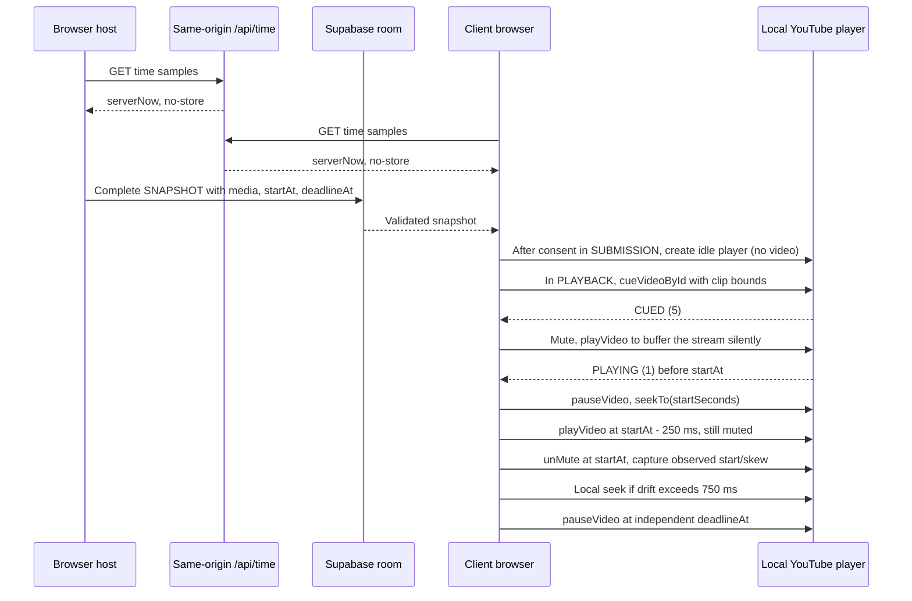

# Architecture

## Implemented in M0

Vite/React strict TypeScript shell, Tailwind styles, Zustand language selection and i18next DE/EN resources. No service is contacted; no game state is persisted. `src/main.tsx` integrates `src/ui/Shell.tsx`. `src/content/genres.json` defines fifty stable bilingual genres. `src/shared/` holds strict Zod primitives, separate defaulted local/required wire settings, GameState/phase/result schemas, commands and network envelopes. UI engine access is restricted to the public `src/engine/selectors.ts` entry when M1 creates it; other engine imports fail lint. Engine net/player/UI dependencies fail lint, including extensionless TypeScript imports.

## Contract invariants

- Settings defaults apply only to local input. Wire settings require every field.
- `rouletteGenrePool` retains the injected 30–50-genre catalogue on every complete snapshot. Active `genrePool` derives from settings: catalogue for roulette, custom items for custom, one fixed genre for fixed. Constructor argument `genrePool` supplies the source catalogue even for a fixed/custom start; switching modes back to roulette restores it, without a module cache or static fallback.
- `roomId` identifies a session; the human room code is not a reservation or authority proof. Only discovery STATE_REQUEST may have null roomId.
- `stateVersion` orders complete snapshots; hostEpoch and hostBaseVersion identify migration lineage. Sender/connection/epoch authority additionally requires M2 adapter context, not just schema validity.
- Unique IDs, record identity, participants, owners, song references, own-rating/flag exclusion, HTTPS i.ytimg.com thumbnails, bounded media/clips and deadlines are validated before state acceptance.
- Zero-song results require zero player and owner deltas, no score, bonus or genre-fail penalty; empty song arrays do not bypass validation.
- Commands carry gameNumber/roundNumber to reject stale same-phase commands. Engine time and nonzero uint32 RNG seed are injected. Orthogonal pause preserves phase; accepted submissions/ratings/flags survive departure.
- No parallel PLAY_EVENT: authoritative playback is solely phase index/startAt/deadlineAt plus round playbackOrder/media in a complete snapshot.
- SNAPSHOT_ACK is one designated replica's schema-accepted receipt, not server ACK or persistence. Snapshot parts are transport frames only; M2 must reassemble atomically and validate the complete event.
- Election and designated-replica ties use locale-independent code-unit clientId ordering after joinedAt. Election prefers players over spectators; replica ACK selection deliberately does not.

## Pure engine and public UI boundary

The M1 kernel is in `src/engine/`. Host/Net integration uses `index.ts`; UI imports only `selectors.ts`. M3 dispatches gameplay commands through the existing GameSession without changing engine or wire contracts.

| API                                                                      | Contract                                                                                                                                                                                                                                                                                                                                                               |
| ------------------------------------------------------------------------ | ---------------------------------------------------------------------------------------------------------------------------------------------------------------------------------------------------------------------------------------------------------------------------------------------------------------------------------------------------------------------- |
| `createInitialState`                                                     | Inject valid room/player IDs, the full catalogue, complete settings, integer normalized server time and a nonzero uint32 seed. Invalid constructor inputs are rejected, not silently normalized.                                                                                                                                                                       |
| `reducer(state, action)`                                                 | Consume schema-valid state/actions; re-check business phase, actor, binding and stale-scope guards. Preserve input data; invalid/no-op returns the same reference. A due deadline is processed before dropping a late command.                                                                                                                                         |
| `classifyCommand`                                                        | Pure protocol rejection reason or null. Fresh unchanged input is `NOT_READY`; cached replay is accepted without applying twice. Adapter uses classification/cache, not a version delta alone. Rate limiting belongs to M2, not this classifier.                                                                                                                        |
| `selectViewerPermissions`, `selectRatingEntries`, `selectFlaggableSongs` | Require `(state, viewerId, viewerConnectionId)`. Missing, stale or unbound connection has no writes; `canWrite` exposes phase-independent bound-tab access for lobby/Sound. `canRate` is the phase-level hint; the per-song `canRate` covers the current song and every earlier one until PLAYBACK ends. Playback genre-fail flags are set-once and never retractable. |
| Presentation / choices                                                   | ID-only presentation reads remain available to stale/read-only tabs. Before reveal, current owners/submission mapping and other players' ratings are absent; linked status/count stays public for the unnamed animation. Own choices stay readable. Revealed history and dense shared standings include departed players.                                              |
| `selectSettings`, `selectGenrePool`                                      | Copy safe lobby settings/active-pool views. UI edits remain local drafts until an action; returned data must not mutate the authoritative state.                                                                                                                                                                                                                       |

Every permanent engine test uses deterministic injected inputs. Coverage excludes `src/engine/fixtures.ts` (test-only helpers) and retains the 90% production-engine line threshold. M1 verifies pure transitions and scoring, not live transport failover or YouTube synchronization.

## M2 lobby and transport

`src/net/transport.ts` defines the room transport seam; `supabaseTransport.ts` lazy-loads the real SDK with public `room:{CODE}`, Broadcast `self:false`/`ack:true`, and Presence keys `clientId:connectionId`. There are no tables or auth sessions. Only a full Presence sync changes membership; successful SDK rejoin callbacks re-track and re-sync rather than using heartbeat/ticker polling.

`GameSession` owns discovery, the host engine, deadline scheduling, command rejection/results, ordered complete snapshots, reassembly, and migration. `createBrowserSession` injects the client identity, per-tab binding, catalogue, clock and lazy transport. Zustand retains language selection only; UI uses the session external store and reads game presentation through public selectors.

Creating waits for subscription and full Presence synchronization, then resolves room-incarnation collisions by lexicographic roomId. A joining client requests a live full snapshot before tracking the discovered roomId and dispatching JOIN. Reload discovers its retained nickname from the snapshot; only clientId is persisted. New tabs rebind, old tabs become read-only. A same-identity host tab uses the explicit old-binding `HOST_HANDOFF`, not an invalid ordinary snapshot.

Migration injects the current full connection list into election and HOST_CHANGED. The candidate collects complete old replicas for 250ms, adopts the highest valid base without merging round data, changes epoch/version, then applies Presence as the new host. Lost sessions are explicit. Server-normalized deadlines are scheduled locally, never broadcast as countdown ticks.

Create/join retry ([PR #36](https://github.com/minercan42-ux/banger-roulette/pull/36)): `createRoom` and `joinRoom` in `src/net/session.ts` rerun their whole first attempt once (`TRANSIENT_RETRY_LIMIT = 1`) after a transient Realtime failure, namely a thrown transport/Presence error for both and an empty discovery (`ROOM_NOT_FOUND`) for joins. The retry detaches the dead transport synchronously, opens a fresh one and, for a create, draws a new room code. Status stays `connecting` throughout and no UI changes. `INVALID_ROOM_CODE`, `INVALID`, `ROOM_FULL`, rejected JOIN results, an exhausted `MAX_CREATE_ATTEMPTS` collision loop, a stale generation and a disposed session are terminal, and a newer create/join cancels a pending retry. The discovery guards and timeouts are unchanged, so a genuinely missing room reports `ROOM_NOT_FOUND` after two discovery windows (about 8 s).

Frames <=192KiB go directly; larger snapshot/handoff/replica events use 48KiB UTF-8 pieces, Base64, <=128 parts/6MiB. Apply only after atomic complete-event validation. Distinct accepted state versions remain FIFO; repeated requests for one version can share a pending publication. Five seconds without new unique valid progress expires an assembly; duplicate parts do not extend it. User approved this inactivity rule to preserve the full codec bounds under fanout-aware pacing.

`api/time.ts` is a GET Web Handler with no-store server milliseconds. Vite invokes this same handler for local development; Vercel deploys it as a Node function. Clock synchronization uses multiple RTT midpoint samples and median offset. Unsynchronized clocks are reported rather than disguised as server time. M4 consumes the existing normalized `GameSession.now()` and clock diagnostics; no new wire event or timer broadcast is introduced.

`e2e/` contains an isolated test-only WebSocket bridge over the actual in-memory transport. Browser hosts still execute the real session/engine and the actual lobby UI. Neither the harness nor its window debug API is a production entry. Live SDK timing is measured separately, without claiming the in-memory results prove Supabase failover bounds. See ADR-002 for connection/version authority.

## M3 genre and submission

`GenreSpin` derives its common target angle from the active pool and the already-drawn genre. Its rotation is a pure function of elapsed phase time from selectors: `ease-wheel` over 2580 ms (the launch is flattened so the speed never increases), a 140 ms pointer flick per passed segment, then a 420 ms shake at the stop with the `GenrePlate` popping in. Spin plus shake always end by the phase deadline (`SPIN_MS` stays 3000; if they do not fit, the shake shrinks first). Pause freezes the same point, late mounting does not start a new draw, fixed mode shows the plate directly and reduced motion jumps to the target with a fade. `HostControls` exposes ready-lobby start and running-room pause/resume/end.

`SubmissionPanel` owns only the local editor and external-player lifecycle. Own accepted media/progress/permissions come from selectors; writes use the exact local connection binding. Changing links, leaving, finishing, pausing or losing the binding aborts metadata and destroys the player, with generation checks suppressing obsolete callbacks. Accepted media survives reload in the host snapshot; no local song persistence or consent persistence is introduced.

`src/player/links.ts` recognizes supported YouTube hosts/routes and bounded whole-second timestamps. `metadata.ts` calls same-origin `/api/oembed`; the GET Web handler uses a fixed upstream URL, disallows redirects, validates normalized title/channel/thumbnail, propagates cancellation and bounds work to five seconds. Vite invokes the same production handler.

The API and its complete shared-schema dependency graph use explicit `.js` relative specifiers so Vercel's emitted Node ESM modules resolve without a bundler. TypeScript/Vite resolve those specifiers to source `.ts` modules during development. Checking `vite build` alone does not exercise that server graph; emitted-JS Node execution and a deployed API request are separate runtime gates.

`iframe.ts` shares the official IFrame API's lazy, timeout-bounded, recoverable singleton and nocookie iframe lifecycle between preview and playback. The iframe includes the application origin and `strict-origin-when-cross-origin`. Preview ready is not proof of playability: only PLAYING plus a positive finite duration for the entered video enables saving. Current video URL is checked again before dispatch, preventing related-video navigation from mixing metadata and duration. Initialization errors are retained, and canceled sessions cannot emit status. Embed failures 2/100/101/150 block; other codes remain unconfirmed rather than becoming success.

At aggregation the existing engine groups video IDs and retains the first remaining submission's media/start. `LinkedAnimation` reads anonymous-safe SongViews during the first playback preroll and in the reveal, and respects reduced motion. M4 plays the resulting shuffled order; M5 adds the live rating, reveal and finale surfaces.

Official sources checked for M3: [IFrame API](https://developers.google.com/youtube/iframe_api_reference), [player parameters](https://developers.google.com/youtube/player_parameters), [privacy-enhanced embedding and Referer](https://support.google.com/youtube/answer/171780?hl=en), [live YouTube oEmbed](https://www.youtube.com/oembed?url=https%3A%2F%2Fwww.youtube.com%2Fwatch%3Fv%3DM7lc1UVf-VE&format=json), [Vercel Node Web handlers](https://vercel.com/docs/functions/runtimes/node-js).

## M4 playback synchronization

`selectPlayback` exposes privacy-safe media, absolute timestamps, frozen pause time and exact viewer-tab flag permissions. `usePlaybackController` in `RoomView` owns one controller per tab. After the embedding consent it is created without a video during SUBMISSION, in a stable host slot rendered at the same tree position in SUBMISSION and PLAYBACK, because moving an iframe reloads it. During SUBMISSION the slot is 200x200 px, transparent, `aria-hidden`, unfocusable and ignores pointer input; it is not hidden or off-screen, which Chrome would throttle. In PLAYBACK the same iframe becomes the visible player. A failed creation is retried when the next plan arrives. Leaving PLAYBACK, consent withdrawal and unmount destroy the frame. `PlaybackPhase` drives this controller and keeps status, recovery, local volume/mute, Genre-Fail, debug and the always-mounted consent checkbox. Only selector-visible owners reach the DOM.

`playback.ts` ignores player states until its own clip cue is issued, because the iframe reports its load state before the clip bounds exist. YouTube can also deliver a late ENDED for the previous video after the next cue, already reporting the new video ID, so ENDED only ends a clip that actually started. Cueing does not fetch the stream, so after CUED the controller mutes (and sets volume 0) and plays to buffer during the three-second preroll. On that PLAYING it pauses and seeks to `startSeconds`, unless less than 500 ms remain, in which case it keeps running muted. The start `playVideo` is issued 250 ms before `startAt` while still muted. Exactly at `startAt` audio is restored and the start is claimed if the media is confirmed PLAYING, otherwise on the next real PLAYING. Invariants: never audible and never claimed before `startAt`. A stall between the muted PLAYING and `startAt` cannot produce a claim. Seek correction requires the expected current video and more than 750 ms drift, with a one-second cooldown. The absolute deadline independently pauses playback, since `seekTo` invalidates YouTube's `endSeconds`. Host pause cancels scheduling and freezes elapsed time; resume uses the engine's shifted timestamps. Terminal errors skip only the local clip. Late PLAYING after pause/error/deadline cannot restart it, and native PLAYING before `startAt` is paused. Autoplay blocking requires a direct recovery gesture; Web Audio unlock alone is not proof.

The opt-in diagnostics overlay (`?debug=1` in the URL or `localStorage['banger-roulette.debug'] = '1'`; hidden from players otherwise, the status text is then screen-reader-only) shows clock offset/RTT/sync, planned start/deadline, observed start, start skew, media drift and status. Start skew is the content offset at the audible start: negative means the media was ahead, positive means it started late. The external-boundary fixture advances media with `performance.now()` independently of injected client wall-clock offsets and follows the documented `seekTo` state rules. Fixture results validate application behavior, not live YouTube timing.

Official M4 sources: [IFrame API](https://developers.google.com/youtube/iframe_api_reference) and [privacy-enhanced embedding/Referer](https://support.google.com/youtube/answer/171780?hl=en). Cueing does not fetch the video stream. Advertisements, cold seeks, buffering, autoplay policies and browser scheduling can prevent the ±500ms target. Presence timeout/partitions can prevent five-second migration; measure AK goals, never represent them as API guarantees. See ADR-001, ADR-002 and SECURITY.md.

## M5 live rating, reveal and finale

M5's rating replaces the former ranking round: the phase order is `LOBBY -> GENRE_SPIN -> SUBMISSION -> PLAYBACK -> REVEAL -> (GENRE_SPIN | FINAL) -> LOBBY` and the separate ranking phase and its setting are gone. The wire adds one event, `RATE {songId, value}` (integer 0-10); `SET_GENRE_FAIL` and `REMATCH` already existed and stay host-validated.

`classifyCommand`/`reducer` accept `RATE` only in PLAYBACK while unpaused, only from a bound participant who does not own the song, only for a song whose position in `playbackOrder` is `<= phase.index` (the current song opens with its preroll and stays open until the phase ends), and only for an integer 0-10; the same value again is `NOT_READY`. `Round.ratings` is `raterId -> videoId -> 0..10`, so a rating can change until PLAYBACK ends and a departed player's ratings stay valid.

`RoomView` renders `PlaybackPhase` (with `RatingSection`), `RevealPhase` (with `Leaderboard`) and `FinalPhase`. `RatingSection` shows one 0-10 chip bar (`RatingBar`) for the playing song and the viewer's own ratings of the songs that already played below it (tap one to change it until the phase ends). Owners see "your song" instead of a bar and nobody sees another player's values before the reveal. Genre-fail is a set-once button for the current song.

`scoreRound` works in integer tenths (`SCORE_TENTHS_PER_POINT = 10`): the song score is `meanTenths` (half up) and owners get it as points; `linkedPoints: 'halfCeil'` halves `ceil((score + bonus) / 2)`. A song with eligible raters but no rating scores `0.0` (`basis: 'noRating'`); a song nobody is eligible to rate pays a fixed `5.0` per owner without halving (`basis: 'noRaters'`) and is excluded from the winner bonus. The best non-failed song(s) with raters get `+2.0` (ties share it); a strict majority of eligible raters flagging costs the genre-fail penalty and excludes the bonus. A round with zero songs is `reason: 'noSongs'`, a single song is scored normally.

`selectReveal` adds server-time staging: entry `i` is revealed at the sum of the preceding `revealSlotMs` values, frozen at `pause.at`, so a banger (`banger: true`: at least one rating and every rating a 10) gets `BANGER_REVEAL_MS = 5000` and every other entry `REVEAL_PER_SONG_MS = 2500`; the phase length is the sum of the slots plus `REVEAL_HOLD_MS`. Resume shifts `startedAt`, so reloads and late joiners see exactly the entries already due. Order is ascending score with the round winner(s) last; a genre-failed song with a higher score therefore never closes the reveal. After the last entry the interim leaderboard shows dense ranks, the round delta and animated moves from `selectStandings().previousRank` (total minus the latest round delta). `FinalPhase` shows the podium (shared places), the full standings, every round's winner links and a host-only rematch. Motion is disabled under `prefers-reduced-motion`.

## M6 audio ownership and sound effects

`src/ui/audio-context.ts` owns one `AudioContext` per tab; the FR-07 consent click no longer keeps it in a component-local `contextRef`. `unlockAudioContext` creates it lazily on that click and proves it really runs, because browsers construct it suspended and a suspended context would swallow every schedule silently. `runningAudioContext` hands the shared context out only in the `running` state and returns `null` otherwise, and `releaseAudioContext` closes and forgets it when the room view unmounts (`useSoundUnlock`, which also owns the per-tab unlock state so the layout may move the `SoundControl` status between the stage and the drawer without losing the permission; the unlock click itself is the `StartGate` button): leaving the room drops the context, and a later consent click in the next room starts a fresh one. The effect layer reads that function per call, so the unlock is the only gate for playing at all.

`src/ui/sfx.ts` synthesizes the seven SPEC §6 effects; no audio file is shipped. Each recipe is a small tone table (waveform, frequency, optional glide, offset, duration, gain) scheduled into one per-effect bus whose master gain is exactly `MASTER_GAIN = 0.2` and which is connected to the destination. Live buses stay registered while they sound and are disconnected once their last tone ends; switching the toggle off fades each of them to zero within 10 ms, so notes of a multi-note effect that are still pending cannot sound after the button already says "off". The shared consent context itself is never closed by a mute, so switching back on plays on the same unlocked context.

The user-facing control is the `sfx-toggle` in the shell header, backed by the Zustand store `src/ui/sfx-store.ts`: default on, in memory only, and independent of the per-tab sound consent (FR-07) and of the server-side `SOUND_STATUS`. It is deliberately not persisted, because `e2e/lobby.spec.ts` asserts that `banger-roulette.clientId` is the only localStorage key (FR-04).

`SfxDirector` renders nothing, is mounted once in `RoomView`, and derives its events from shared state through the pure `sfxEventsFor(prev, next)` over an `SfxSnapshot`: every client reads the same sound design, and no phase component owns audio. Nothing plays while the next phase is `PLAYBACK`, which would overlap the preroll or the clip. `spinTick` follows the wheel's 120 ms tick cadence and freezes while the room is paused, `spinStop` the settle, `linked` fires when a linked entry reaches the reveal screen, the first place a link is public (AK-3), `revealEntry` and `jackpot` follow the entry staging, a banger entry (every rating 10) plays `banger` instead of both (`bangerEntries` of the snapshot; the winning banger is not counted as a jackpot winner), and `final` the transition into FINALE. The first snapshot of a session is a position, not a transition, so joining late or reloading fires no backlog. The effects are covered twice: `src/ui/sfx.test.ts` asserts scheduling, the gain ceiling, the silent toggle and the mute on a mocked context, and `e2e/sfx-render.spec.ts` renders every production recipe through `renderEvents` on an `OfflineAudioContext` in Chromium and measures the peak and RMS that reach the destination (silence for the off control, silence after a mute mid-effect).

The render spec runs in every Playwright project ([PR #50](https://github.com/minercan42-ux/banger-roulette/pull/50)), so on `main` it also renders in Firefox and WebKit. Firefox has no `OfflineAudioContext.suspend()`, so the mute is applied before the render there instead of mid-effect. The sound effects landed in [PR #52](https://github.com/minercan42-ux/banger-roulette/pull/52).

## M6 shell, privacy notice and gates

`Shell` renders one persistent `<footer data-testid="privacy-notice">` on every screen ([PR #55](https://github.com/minercan42-ux/banger-roulette/pull/55), NFR-04): YouTube is embedded from `youtube-nocookie.com` only after the consent from the start gate, no analytics or cookies, and the only stored items are the random player ID and the YouTube consent choice. `StartGate` (#96) is one modal opened by `RoomView` for a seated player: full form ("Los geht's" grants consent and unlocks audio in one click, "Ohne Videos" unlocks audio only) while the consent is undecided, one-tap "Tippen zum Starten" when the consent is stored but this page load's audio is still locked (Esc closes only that form). It traps focus and takes initial focus. `ConsentControl` in the drawer revokes or re-grants the consent. `PhaseAnnouncer` ([PR #40](https://github.com/minercan42-ux/banger-roulette/pull/40)) is an `aria-live` region mounted for the whole room lifecycle: it announces each observed phase change and stays silent on a fresh mount (enter, reload, reconnect). The casino frame uses CSS tokens, a decorative `Chip` and one global focus ring ([PR #39](https://github.com/minercan42-ux/banger-roulette/pull/39)); the phase screens keep their earlier styling while the Pixel-Filz redesign plan ([#45](https://github.com/minercan42-ux/banger-roulette/issues/45)) is undecided.

`src/main.tsx` switches zod to jitless mode before any schema is built, because zod's `new Function("")` probe would otherwise raise a CSP `eval` violation on every page load ([PR #48](https://github.com/minercan42-ux/banger-roulette/pull/48)). CI gates NFR-01 with `scripts/bundle-check.mjs` (250 kB gzip initial JS, [PR #47](https://github.com/minercan42-ux/banger-roulette/pull/47)) and Lighthouse CI over the production build ([PR #49](https://github.com/minercan42-ux/banger-roulette/pull/49)); `e2e-cross-browser` runs Firefox and WebKit nightly (`schedule`, 03:00 UTC) and on demand (`workflow_dispatch`) only. The committed live smoke (`e2e-live/`, [PR #42](https://github.com/minercan42-ux/banger-roulette/pull/42)) is manual: `live-smoke.yml` is `workflow_dispatch`-only ([PR #54](https://github.com/minercan42-ux/banger-roulette/pull/54)).
