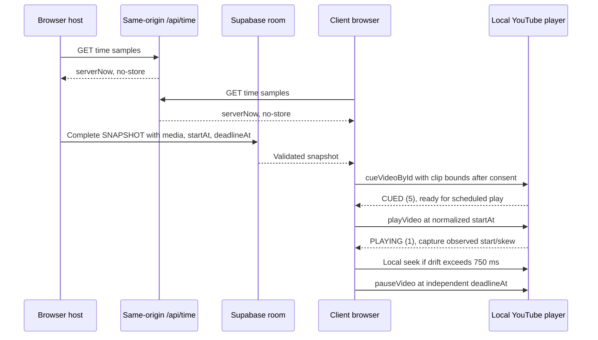

# Architecture

## Implemented in M0

Vite/React strict TypeScript shell, Tailwind styles, Zustand language selection and i18next DE/EN resources. No service is contacted; no game state is persisted. `src/main.tsx` integrates `src/ui/Shell.tsx`. `src/content/genres.json` defines fifty stable bilingual genres. `src/shared/` holds strict Zod primitives, separate defaulted local/required wire settings, GameState/phase/result schemas, commands and network envelopes. UI engine access is restricted to the public `src/engine/selectors.ts` entry when M1 creates it; other engine imports fail lint. Engine net/player/UI dependencies fail lint, including extensionless TypeScript imports.

## Contract invariants

- Settings defaults apply only to local input. Wire settings require every field.
- `rouletteGenrePool` retains the injected 30–50-genre catalogue on every complete snapshot. Active `genrePool` derives from settings: catalogue for roulette, custom items for custom, one fixed genre for fixed. Constructor argument `genrePool` supplies the source catalogue even for a fixed/custom start; switching modes back to roulette restores it, without a module cache or static fallback.
- `roomId` identifies a session; the human room code is not a reservation or authority proof. Only discovery STATE_REQUEST may have null roomId.
- `stateVersion` orders complete snapshots; hostEpoch and hostBaseVersion identify migration lineage. Sender/connection/epoch authority additionally requires M2 adapter context, not just schema validity.
- Unique IDs, record identity, participants, owners, song references, own-vote/flag exclusion, HTTPS i.ytimg.com thumbnails, bounded media/clips and deadlines are validated before state acceptance.
- Zero/one-song results require zero player and owner deltas, no Borda, bonus or genre-fail penalty; empty song arrays do not bypass validation.
- Commands carry gameNumber/roundNumber to reject stale same-phase commands. Engine time and nonzero uint32 RNG seed are injected. Orthogonal pause preserves phase; accepted submissions/ballots/flags survive departure.
- No parallel PLAY_EVENT: authoritative playback is solely phase index/startAt/deadlineAt plus round playbackOrder/media in a complete snapshot.
- SNAPSHOT_ACK is one designated replica's schema-accepted receipt, not server ACK or persistence. Snapshot parts are transport frames only; M2 must reassemble atomically and validate the complete event.
- Election and designated-replica ties use locale-independent code-unit clientId ordering after joinedAt. Election prefers players over spectators; replica ACK selection deliberately does not.

## Pure engine and public UI boundary

The M1 kernel is in `src/engine/`. Host/Net integration uses `index.ts`; UI imports only `selectors.ts`. M3 dispatches gameplay commands through the existing GameSession without changing engine or wire contracts.

| API                                                                      | Contract                                                                                                                                                                                                                                                                                                         |
| ------------------------------------------------------------------------ | ---------------------------------------------------------------------------------------------------------------------------------------------------------------------------------------------------------------------------------------------------------------------------------------------------------------- |
| `createInitialState`                                                     | Inject valid room/player IDs, the full catalogue, complete settings, integer normalized server time and a nonzero uint32 seed. Invalid constructor inputs are rejected, not silently normalized.                                                                                                                 |
| `reducer(state, action)`                                                 | Consume schema-valid state/actions; re-check business phase, actor, binding and stale-scope guards. Preserve input data; invalid/no-op returns the same reference. A due deadline is processed before dropping a late command.                                                                                   |
| `classifyCommand`                                                        | Pure protocol rejection reason or null. Fresh unchanged input is `NOT_READY`; cached replay is accepted without applying twice. Adapter uses classification/cache, not a version delta alone. Rate limiting belongs to M2, not this classifier.                                                                  |
| `selectViewerPermissions`, `selectEligibleSongs`, `selectFlaggableSongs` | Require `(state, viewerId, viewerConnectionId)`. Missing, stale or unbound connection has no writes; `canWrite` exposes phase-independent bound-tab access for lobby/Sound. Finished voting closes ranking and flags. Playback flags are set-once, voting flags retractable until finish.                        |
| Presentation / choices                                                   | ID-only presentation reads remain available to stale/read-only tabs. Before reveal, current owners/submission mapping and other ballots are absent; linked status/count stays public for the unnamed animation. Own choices stay readable. Revealed history and dense shared standings include departed players. |
| `selectSettings`, `selectGenrePool`                                      | Copy safe lobby settings/active-pool views. UI edits remain local drafts until an action; returned data must not mutate the authoritative state.                                                                                                                                                                 |

Every permanent engine test uses deterministic injected inputs. Coverage excludes `src/engine/fixtures.ts` (test-only helpers) and retains the 90% production-engine line threshold. M1 verifies pure transitions and scoring, not live transport failover or YouTube synchronization.

## M2 lobby and transport

`src/net/transport.ts` defines the room transport seam; `supabaseTransport.ts` lazy-loads the real SDK with public `room:{CODE}`, Broadcast `self:false`/`ack:true`, and Presence keys `clientId:connectionId`. There are no tables or auth sessions. Only a full Presence sync changes membership; successful SDK rejoin callbacks re-track and re-sync rather than using heartbeat/ticker polling.

`GameSession` owns discovery, the host engine, deadline scheduling, command rejection/results, ordered complete snapshots, reassembly, and migration. `createBrowserSession` injects the client identity, per-tab binding, catalogue, clock and lazy transport. Zustand retains language selection only; UI uses the session external store and reads game presentation through public selectors.

Creating waits for subscription and full Presence synchronization, then resolves room-incarnation collisions by lexicographic roomId. A joining client requests a live full snapshot before tracking the discovered roomId and dispatching JOIN. Reload discovers its retained nickname from the snapshot; only clientId is persisted. New tabs rebind, old tabs become read-only. A same-identity host tab uses the explicit old-binding `HOST_HANDOFF`, not an invalid ordinary snapshot.

Migration injects the current full connection list into election and HOST_CHANGED. The candidate collects complete old replicas for 250ms, adopts the highest valid base without merging round data, changes epoch/version, then applies Presence as the new host. Lost sessions are explicit. Server-normalized deadlines are scheduled locally, never broadcast as countdown ticks.

Frames <=192KiB go directly; larger snapshot/handoff/replica events use 48KiB UTF-8 pieces, Base64, <=128 parts/6MiB. Apply only after atomic complete-event validation. Distinct accepted state versions remain FIFO; repeated requests for one version can share a pending publication. Five seconds without new unique valid progress expires an assembly; duplicate parts do not extend it. User approved this inactivity rule to preserve the full codec bounds under fanout-aware pacing.

`api/time.ts` is a GET Web Handler with no-store server milliseconds. Vite invokes this same handler for local development; Vercel deploys it as a Node function. Clock synchronization uses multiple RTT midpoint samples and median offset. Unsynchronized clocks are reported rather than disguised as server time. M4 consumes the existing normalized `GameSession.now()` and clock diagnostics; no new wire event or timer broadcast is introduced.

`e2e/` contains an isolated test-only WebSocket bridge over the actual in-memory transport. Browser hosts still execute the real session/engine and the actual lobby UI. Neither the harness nor its window debug API is a production entry. Live SDK timing is measured separately, without claiming the in-memory results prove Supabase failover bounds. See ADR-002 for connection/version authority.

## M3 genre and submission

`GenreSpin` derives its common target angle from the active pool and the already-drawn genre. Its rotation follows normalized elapsed phase time from selectors; pause freezes the same point, late mounting does not start a new draw, fixed mode shows a brief notice and reduced motion jumps to the target. `HostControls` exposes ready-lobby start and running-room pause/resume/end.

`SubmissionPanel` owns only the local editor and external-player lifecycle. Own accepted media/progress/permissions come from selectors; writes use the exact local connection binding. Changing links, leaving, finishing, pausing or losing the binding aborts metadata and destroys the player, with generation checks suppressing obsolete callbacks. Accepted media survives reload in the host snapshot; no local song persistence or consent persistence is introduced.

`src/player/links.ts` recognizes supported YouTube hosts/routes and bounded whole-second timestamps. `metadata.ts` calls same-origin `/api/oembed`; the GET Web handler uses a fixed upstream URL, disallows redirects, validates normalized title/channel/thumbnail, propagates cancellation and bounds work to five seconds. Vite invokes the same production handler.

The API and its complete shared-schema dependency graph use explicit `.js` relative specifiers so Vercel's emitted Node ESM modules resolve without a bundler. TypeScript/Vite resolve those specifiers to source `.ts` modules during development. Checking `vite build` alone does not exercise that server graph; emitted-JS Node execution and a deployed API request are separate runtime gates.

`iframe.ts` shares the official IFrame API's lazy, timeout-bounded, recoverable singleton and nocookie iframe lifecycle between preview and playback. The iframe includes the application origin and `strict-origin-when-cross-origin`. Preview ready is not proof of playability: only PLAYING plus a positive finite duration for the entered video enables saving. Current video URL is checked again before dispatch, preventing related-video navigation from mixing metadata and duration. Initialization errors are retained, and canceled sessions cannot emit status. Embed failures 2/100/101/150 block; other codes remain unconfirmed rather than becoming success.

At aggregation the existing engine groups video IDs and retains the first remaining submission's media/start. `LinkedAnimation` reads anonymous-safe SongViews during the first playback preroll, or the single-song reveal, and respects reduced motion. M4 plays the resulting shuffled order; voting/reveal/finale surfaces remain M5.

Official sources checked for M3: [IFrame API](https://developers.google.com/youtube/iframe_api_reference), [player parameters](https://developers.google.com/youtube/player_parameters), [privacy-enhanced embedding and Referer](https://support.google.com/youtube/answer/171780?hl=en), [live YouTube oEmbed](https://www.youtube.com/oembed?url=https%3A%2F%2Fwww.youtube.com%2Fwatch%3Fv%3DM7lc1UVf-VE&format=json), [Vercel Node Web handlers](https://vercel.com/docs/functions/runtimes/node-js).

## M4 playback synchronization

`selectPlayback` exposes privacy-safe media, absolute timestamps, frozen pause time and exact viewer-tab flag permissions. `PlaybackPhase` shares in-memory per-tab consent with submission, maintains local volume/mute, and restarts pending creations when the authoritative plan changes. Live controllers update in place across songs. The consent checkbox stays mounted, so consent can be withdrawn during playback; withdrawal and unmount abort work and destroy the frame. Only selector-visible owners reach the DOM.

`playback.ts` ignores player states until its own clip cue is issued: the iframe reports its URL video before the clip bounds exist, and acting on that CUED would start playback that the following cue stops again. It then waits for CUED before requesting playback, catches up after delayed cue or buffering, and samples drift every 250 ms. Seek requires the expected current video and more than 750 ms drift, with a one-second cooldown. The absolute deadline independently pauses playback, since `seekTo` invalidates YouTube's `endSeconds`. Host pause cancels scheduling and freezes elapsed time; resume uses the engine's shifted timestamps. Terminal errors skip only the local clip. Late PLAYING events after pause/error/deadline cannot restart it, and native PLAYING before `startAt` is paused until the scheduled start. Autoplay blocking requires a direct recovery gesture; Web Audio unlock alone is not proof.

The opt-in `?debug=1` overlay shows existing clock offset/RTT/sync plus planned start/deadline, first actual PLAYING time/skew, media drift and status. The external-boundary fixture advances media with `performance.now()` independently of injected client wall-clock offsets. Fixture results validate application behavior, not live YouTube timing.

Official M4 sources: [IFrame API](https://developers.google.com/youtube/iframe_api_reference) and [privacy-enhanced embedding/Referer](https://support.google.com/youtube/answer/171780?hl=en). Cueing does not fetch the video stream. Advertisements, cold seeks, buffering, autoplay policies and browser scheduling can prevent the ±500ms target. Presence timeout/partitions can prevent five-second migration; measure AK goals, never represent them as API guarantees. See ADR-001, ADR-002 and SECURITY.md.
